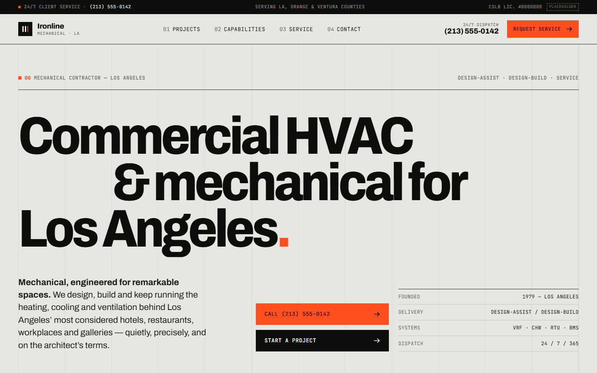

<div align="center">

# Ironline Mechanical

**Commercial HVAC & mechanical for Los Angeles**

A bespoke website concept for a design-assist mechanical contractor serving boutique hotels, restaurants, creative offices and galleries.


</div>



> [!NOTE]
> **Design concept.** Ironline Mechanical is a fictional company created for portfolio purposes. Names, phone numbers (555), the `.example` domain, the license number and all architect, GC and client credits are placeholders. No reviews or ratings are invented: review areas are clearly marked widget slots.

---

## Overview

Ironline is a commercial and hospitality mechanical contractor working from design-assist through 24/7 service. The site speaks to two audiences:

- **Architects, GCs and owners** who need preconstruction, VRF and chilled-water expertise, and proof on real projects
- **Facility managers** with a system down, who need dispatch in one tap

The visual direction is Swiss-grid architectural modernism: a visible 12-column grid, oversized Archivo headlines, JetBrains Mono for data and labels, spec-sheet details (tonnage, CFM, coordinates, figure numbers) and a single signal-orange accent.

## Pages

| Page | File | What it does |
|---|---|---|
| Home | `index.html` | Hero with spec tags on the photo, credentials strip, sector marquee, horizontal project strip, capabilities, count-up numbers, process, reviews slot, 24/7 band, quick estimate + service plan |
| Projects | `projects.html` | 8 projects with sector filters and a grid/list view toggle |
| Case study | `project-arts-district-hotel.html` | Hotel Calder: spec table, challenge / solution / outcome, metrics, lightbox gallery |
| Capabilities | `capabilities.html` | Five disciplines with spec grids and technical tags |
| VRF Systems | `service-vrf-systems.html` | Dedicated service page with FAQ |
| Kitchen Ventilation | `service-kitchen-ventilation.html` | Type I/II hoods, make-up air, NFPA 96, approvals, with FAQ |
| Downtown LA & Arts District | `area-downtown-la-arts-district.html` | Area page: alley access, crane picks, adaptive reuse, Title 24 |
| Service | `service.html` | Dispatch timeline (T+00 to T+2H) and a three-tier plan comparison table |
| Contact | `contact.html` | Two tabs, Start a Project or Request Service, with an upload placeholder |
| Thank you | `thank-you.html` | Confirmation with four next steps |

## Features

- **Horizontal project strip** with prev/next controls and a progress bar, contained so the page never scrolls sideways
- **Sector marquee** that pauses on hover and stops under reduced motion
- **Count-up figures** triggered on scroll
- **Grid/list toggle** on the projects page, remembered per visitor
- **Tabbed contact flow** with deep links (`contact.html#service`), validation and a generated reference number
- **Phone formatting** as you type, and a drag-and-drop zone for plans (UI only)
- **Sticky mobile action bar** with Call 24/7 and Request Service
- **Structured data**: `HVACBusiness` on every page, plus `Service` and `FAQPage` where relevant

## Design system

| Token | Value | Use |
|---|---|---|
| Concrete | `#e7e6e1` | Page ground |
| Paper | `#f2f1ed` | Cards and panels |
| Ink | `#0d0d0c` | Type, dark bands |
| Muted | `#5d5c57` | Labels, meta |
| Signal orange | `#ff4f1f` | Calls to action only |

**Type:** Archivo (variable width and weight) with JetBrains Mono for data, via Google Fonts.

## HVAC conversion checklist

Built against a conversion checklist drawn from top-performing HVAC sites:

- [x] Call and booking visible without scrolling on mobile
- [x] Sticky mobile call/service bar
- [x] Credentials and rating slot directly under the hero
- [x] Service plan placed beside the estimate form
- [x] Separate service pages and a unique area page
- [x] `HVACBusiness` schema on every page
- [x] Estimate form with 5 fields or fewer, plus a thank-you page
- [x] License, insurance and trade affiliations shown
- [x] 24/7 emergency dispatch messaging

## Run locally

No build step or dependencies are needed. Serve the folder with any static server:

```bash
python -m http.server 8000
```

Then open <http://localhost:8000>. You can also open `index.html` directly in a browser.

## Project structure

```text
ironline-mechanical/
├── index.html
├── projects.html
├── project-arts-district-hotel.html
├── capabilities.html
├── service-vrf-systems.html
├── service-kitchen-ventilation.html
├── area-downtown-la-arts-district.html
├── service.html
├── contact.html
├── thank-you.html
├── css/
│   └── styles.css
├── js/
│   └── main.js
└── docs/
    └── preview.png
```

## Credits

- Photography from [Unsplash](https://unsplash.com), used under the Unsplash License. A production site would use the client's own project photography.
- Fonts from [Google Fonts](https://fonts.google.com).
